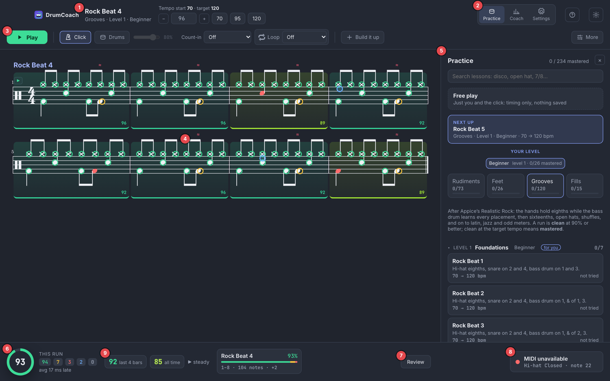

# DrumCoach

A practice coach for electronic drum kits, for the Mac. Pick a lesson, hear
it, play it with the click, and every hit from your kit is graded against the
written notes as you play.

  

Version 1.18.1 · free · for Macs with Apple silicon (M1 or later) ·
signed and notarized by Apple · [all versions](https://github.com/meolsen/drumcoach/releases)

## What it does

- **234 lessons** in four strands: rudiments and hand studies, feet and
  independence drills, grooves, and fills, in five levels from first week to advanced.
- **Build it up.** A groove that will not come together can be played one layer at a
  time: hi-hat first, then the snare, then the bass drum a note at a time.
- **Grades every hit.** A green ring is on time, a yellow ring is early or
  late and shows which, a red note was missed, a blue ring is a stray hit.
  Each bar gets its own score.
- **Search.** Type "open hat", "ghost notes", "7/8" or "four on the floor" and it finds
  the lessons that have it.
- **Free play.** Just you and the click: play anything and see how tightly you hold the
  tempo, including with the click dropping out.
- **Works with your kit.** A picture of a kit to hit and confirm, for three pieces or ten.
- **Tells you where to play.** Four bands, Beginner to Advanced. The app
  recommends one from what you have mastered and suggests moving up when you
  are ready.
- **Coaches.** After each run: your score, the one thing most worth working
  on, and whether to go faster, again or slower. Coach tips go into detail.
- **Drills.** Loop any bars, raise the tempo automatically after clean passes,
  drop the click out for a few bars, or climb a tempo ladder to find your top
  clean tempo.
- **Keeps your history** for every lesson, and can print a graded run as a PDF.
- **Private.** Everything stays on your Mac. The app makes no network
  connections.

## What you need

- A Mac with Apple silicon (M1 or later).
- An electronic drum kit that sends MIDI over USB or Bluetooth. Without a kit,
  the computer keyboard works as practice pads.
- Headphones. Wired is better: Bluetooth headphones add delay.

## Which kits work

DrumCoach recognises the make of your kit when you plug it in and sets the
pads up for it. Then **Set up my kit** shows a picture of a kit: hit each pad
and the drum the app hears lights up. If the wrong one lights, click the right
one. Pads your kit does not have can be marked, and a neighbouring drum stands
in for them in the lessons. That works for any kit, whatever its make or size.

| Kit | Status |
|---|---|
| Roland V-Drums (V and TD series) | Built and tested on a V51, including rims, cymbal edges and bells, chokes and the hi-hat pedal |
| Alesis (Nitro, Surge, Crimson, Strike) | Set up from Alesis's published pad table. **Not yet tried on a real kit** |
| Yamaha DTX | Set up from Yamaha's published pad table. **Not yet tried on a real kit** |
| Anything else | Starts from the General MIDI layout; use Set up my kit to finish it |

If you have one of the untried kits, your report is the most useful thing you
can send.

## Tell me how it goes

DrumCoach was built and tested on one kit by one drummer, so I'd like to hear
from you, whatever happened:

- **[My kit works / doesn't work](https://github.com/meolsen/drumcoach/issues/new?template=kit-report.yml)**: in the app, open Set up my kit, press **Copy kit report** and paste it in.
- **[Something went wrong](https://github.com/meolsen/drumcoach/issues/new?template=problem.yml)**: a hit graded unfairly, a lesson that looks wrong, anything broken.
- **[An idea or request](https://github.com/meolsen/drumcoach/issues/new?template=idea.yml)**: lessons or features you'd like.

You need a free GitHub account to post. [See what others have reported](https://github.com/meolsen/drumcoach/issues).

## Installing

1. Press the download button above and open the file.
2. Drag **DrumCoach** onto **Applications**.
3. Open DrumCoach. The first time, it finds your kit, offers **Set up my kit**
   and a twenty-second timing calibration. Do both: they make the scores fair.
4. Press **?** in the app for the full manual, with pictures.

To update, download the new version and replace the old one. Your progress is
kept.

## Licence and credits

DrumCoach is free to use; see the [licence](LICENSE.md). The source code is not
published. It is built on open-source components, listed in the
[credits](CREDITS.md).
