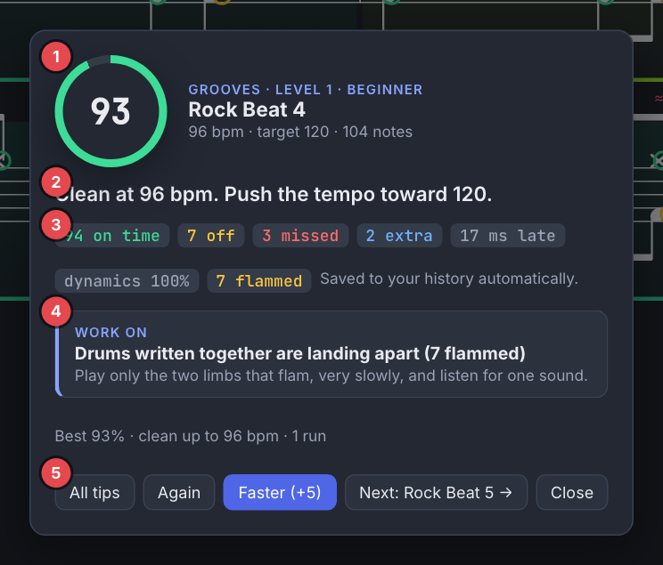

# DrumCoach

A practice coach for electronic drum kits, for the Mac. Pick a lesson, hear
it, play it with the click, and every hit from your kit is graded against the
written notes as you play.

  

Version 1.10.0 · free · for Macs with Apple silicon (M1 or later) ·
signed and notarized by Apple · [all versions](https://github.com/meolsen/drumcoach/releases)

## What it does

- **208 lessons** in three strands: rudiments and hand studies, grooves, and
  fills, in five levels from first week to advanced.
- **Grades every hit.** A green ring is on time, a yellow ring is early or
  late and shows which, a red note was missed, a blue ring is a stray hit.
  Each bar gets its own score.
- **Tells you where to play.** Four bands, Beginner to Advanced. The app
  recommends one from what you have mastered and suggests moving up when you
  are ready.
- **Coaches.** After each run: your score, the one thing most worth working
  on, and whether to go faster, again or slower. Coach tips go into detail.
- **Drills.** Loop any bars, raise the tempo automatically after clean passes,
  drop the click out for a few bars, or climb a tempo ladder to find your top
  clean tempo.
- **Keeps your history** for every lesson, and can print a graded run as a PDF.
- **Private.** Everything stays on your Mac. The app makes no network
  connections.

## What you need

- A Mac with Apple silicon (M1 or later).
- An electronic drum kit that sends MIDI over USB or Bluetooth. It was built
  with a Roland V-Drums kit; other General MIDI kits work, and any pad can be
  re-assigned in Settings. Without a kit, the computer keyboard works as
  practice pads.
- Headphones. Wired is better: Bluetooth headphones add delay.

## Installing

1. Press the download button above and open the file.
2. Drag **DrumCoach** onto **Applications**.
3. Open DrumCoach. The first time, it checks that your kit is connected and
   offers a twenty-second timing calibration. Do it: it makes the scores fair.
4. Press **?** in the app for the full manual, with pictures.

To update, download the new version and replace the old one. Your progress is
kept.

## Licence and credits

DrumCoach is free to use; see the [licence](LICENSE.md). The source code is not
published. It is built on open-source components, listed in the
[credits](CREDITS.md).
